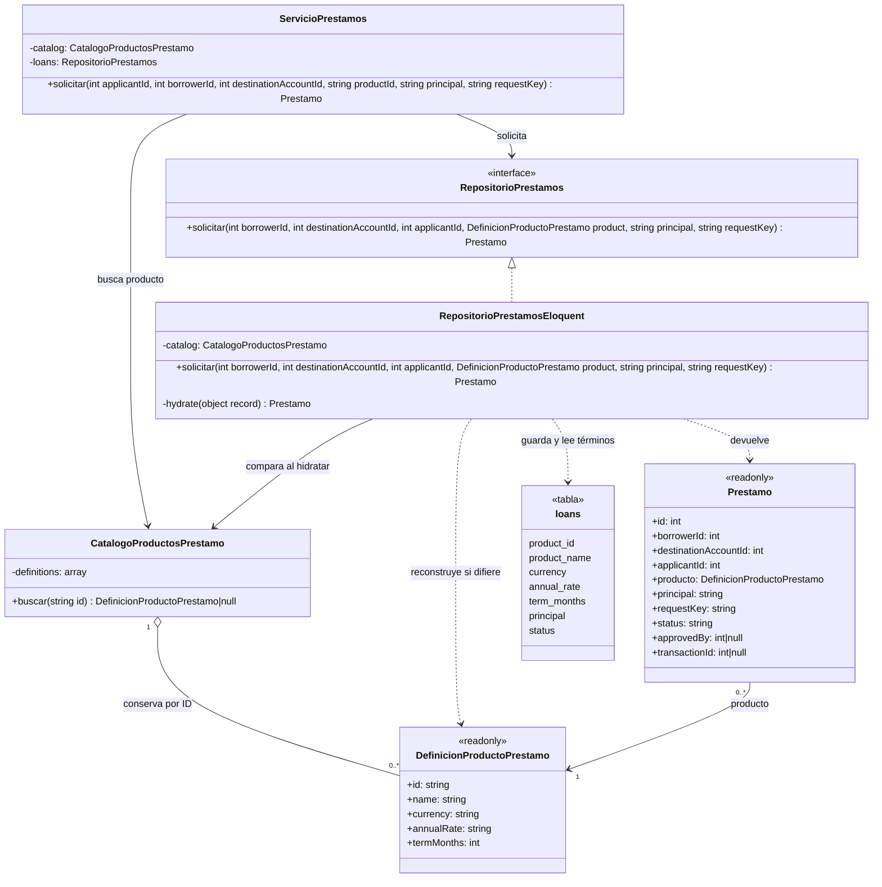

# Semana 10 — UML de Flyweight en préstamos

El diagrama representa la reutilización de definiciones dentro de un catálogo y la frontera con los términos históricos persistidos. Las flechas indican dependencias y referencias de objetos, no un pool compartido entre procesos.

## Diagrama de clases — Flyweight y persistencia

## Lectura y límites del modelo

- Dos `Prestamo` del mismo catálogo pueden referenciar la misma `DefinicionProductoPrestamo` cuando seleccionan el mismo producto. Sus datos individuales permanecen separados.
- `RepositorioPrestamosEloquent` guarda la instantánea de los términos en `loans`. Si los términos actuales del catálogo no coinciden con los persistidos, `hydrate` construye una definición histórica con los términos de esa fila; el diagrama **no** promete identidad de objeto para definiciones históricas.
- `DefinicionProductoPrestamo` valida moneda (`COP` o `USD`), formato de tasa anual y plazo positivo al construirla. Esta restricción pertenece a la definición, no a reglas de desembolso.
- Desembolso, ledger, cuenta interna CORE e idempotencia no forman parte de este diagrama Flyweight: son responsabilidades de integración separadas en `ServicioPrestamos`.

**Referencias:** `app/Domain/Loan/CatalogoProductosPrestamo.php`, `app/Domain/Loan/DefinicionProductoPrestamo.php`, `app/Domain/Loan/Prestamo.php`, `app/Application/Loan/ServicioPrestamos.php`, `app/Domain/Loan/RepositorioPrestamos.php`, `app/Infrastructure/Persistence/RepositorioPrestamosEloquent.php`. Explicación y evidencia en `Semana 10 - Flyweight.md`. El código Mermaid es editable; no se encontró un renderizador Mermaid local instalado para generar `Semana 10 - UML Flyweight.png`.
