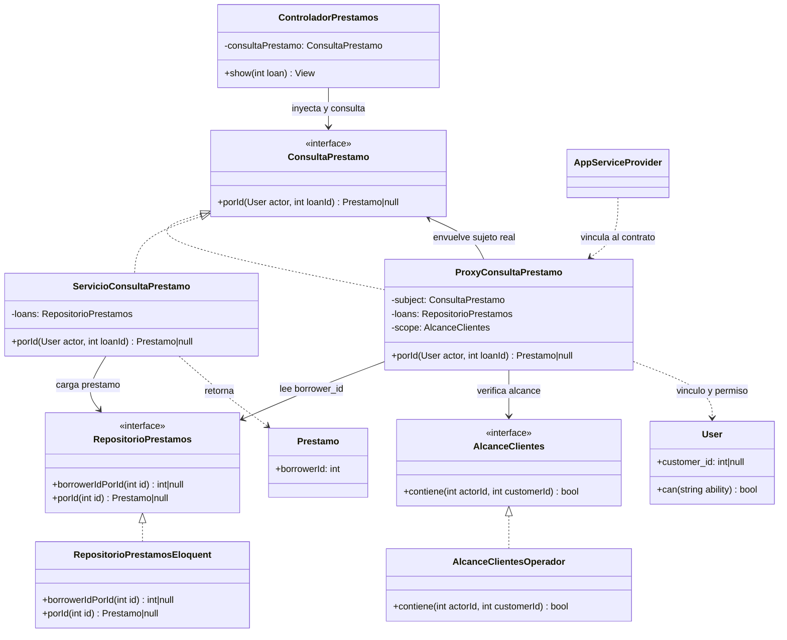
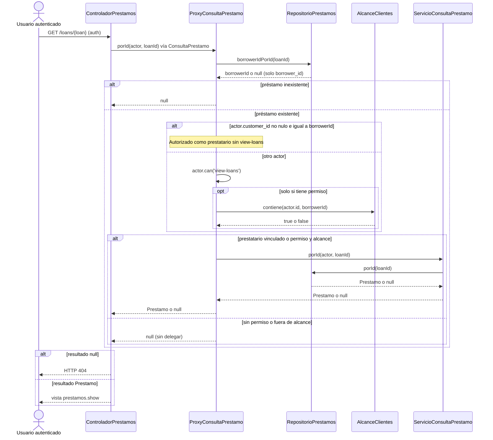

# Semana 11 — UML de Protection Proxy para préstamos

Los diagramas muestran la consulta `GET /loans/{loan}` registrada bajo `auth`. El contrato inyectado en el controlador es `ConsultaPrestamo`; el sujeto real **no** se inyecta allí directamente. Mermaid es editable; no se generó PNG porque no hay CLI local.

## Diagrama de clases — participantes reales

`AppServiceProvider` construye el Proxy con `ServicioConsultaPrestamo`, `RepositorioPrestamos` y `AlcanceClientes`; la relación del Proxy hacia `ConsultaPrestamo` representa ese sujeto envuelto. `User.customer_id` es opcional y no se infiere de email ni de la igualdad de IDs.

## Diagrama de secuencia — autorización antes de lectura completa

## Lectura y límites

- Solo los dos caminos autorizados (vínculo explícito, o permiso **y** alcance) llegan al sujeto real; el Proxy delega **una vez**. Si falta permiso, el alcance ni siquiera se consulta.
- Para un operador no prestatario, permiso y alcance son necesarios a la vez: `AlcanceClientesOperador::contiene` verifica una cuenta con `operado_por = actor.id` y `customer_id = borrowerId`. `view-loans` está registrado, no asignado automáticamente.
- La ruta no usa `can:view-loans` como guard exclusivo: el Proxy resuelve el acceso de prestatarios y operadores. `null` por ausencia o denegación llega al mismo 404; el sujeto real carga el préstamo sin efectuar ese control.
- La secuencia ilustra lectura, no solicitud, aprobación ni desembolso. No atribuye reglas de financiación al Proxy ni promete atomicidad entre la primera lectura de `borrower_id` y la carga del préstamo.

**Referencias:** `app/Application/Loan/ConsultaPrestamo.php`, `app/Application/Loan/ProxyConsultaPrestamo.php`, `app/Application/Loan/ServicioConsultaPrestamo.php`, `app/Domain/Loan/RepositorioPrestamos.php`, `app/Infrastructure/Persistence/RepositorioPrestamosEloquent.php`, `app/Application/Account/AlcanceClientes.php`, `app/Infrastructure/Persistence/AlcanceClientesOperador.php`, `app/Providers/AppServiceProvider.php`, `app/Http/Controllers/ControladorPrestamos.php`, `routes/web.php`. Explicación y matriz en `Semana 11 - Proxy.md`.
