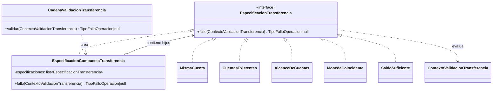
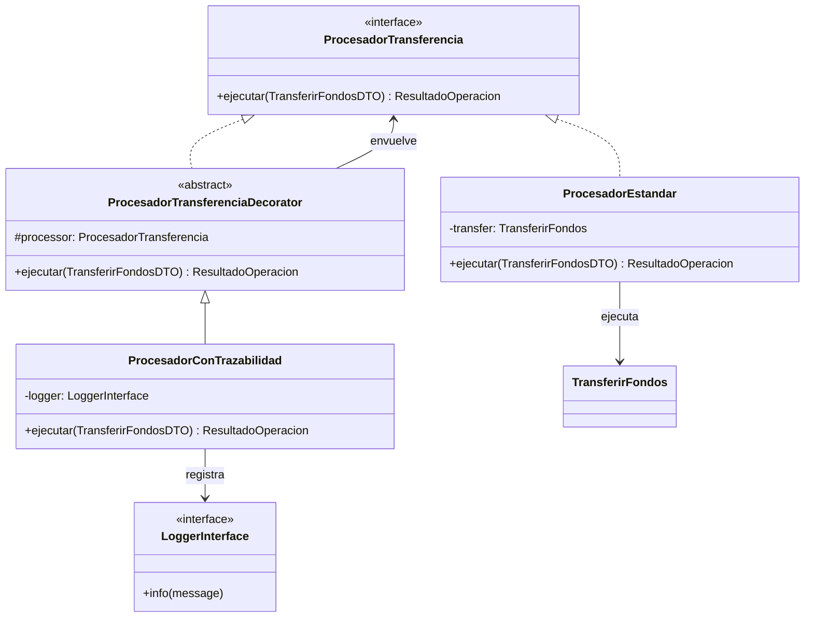
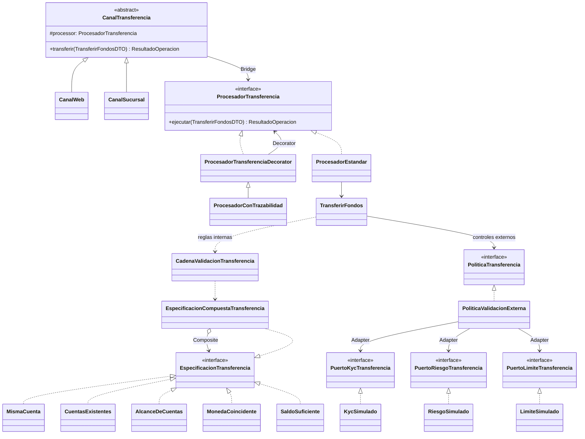

# Semana 8 — UML de Composite y Decorator

Los diagramas describen las relaciones verificadas en `app/Application/Account/` y la composición registrada en `app/Providers/AppServiceProvider.php`. Las imágenes PNG del mismo directorio están preparadas para insertar en Word: `Semana 8 - UML Composite.png`, `Semana 8 - UML Decorator.png` y `Semana 8 - UML Integrado.png`.

## Composite: especificaciones internas

`CadenaValidacionTransferencia` crea el compuesto con la lista recibida; `TransferirFondos` declara el orden de las cinco hojas. Cada hijo recibe el mismo `ContextoValidacionTransferencia` y devuelve `TipoFalloOperacion` o `null`.

## Decorator: trazabilidad del procesador

El decorador implementa el mismo contrato que el procesador envuelto. `ProcesadorConTrazabilidad` usa `LoggerInterface` y delega sin alterar el resultado en el retorno normal. El contenedor enlaza `ProcesadorTransferencia` a un decorador sobre `ProcesadorEstandar`.

## Vista integrada: cuatro patrones, un flujo

Las flechas muestran dependencias de la ruta principal, no llamadas obligatorias para cada variante del procesador. `PoliticaValidacionExterna` queda fuera del árbol Composite y usa puertos externos; el canal referencia el contrato de procesador, no una implementación fija.

**Lectura del flujo:** canal → procesador decorado → procesador estándar → caso de uso → especificaciones internas → política externa → escritura transaccional si se aprueba. El compuesto corta en el primer fallo; el decorador no implementa reglas financieras. La variante `ProcesadorControlado` puede sumar una política adicional después de la externa.
