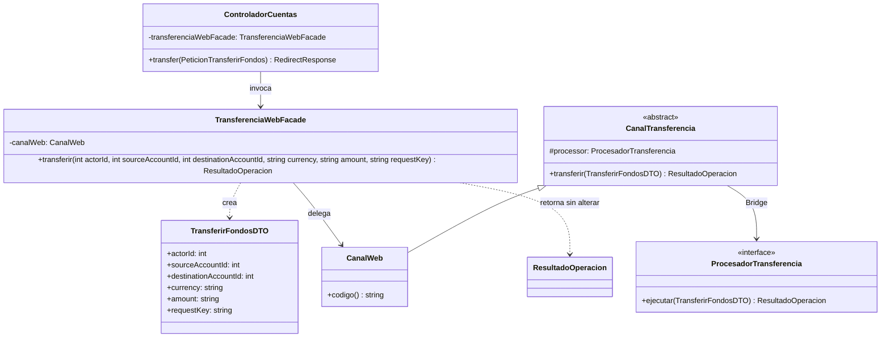
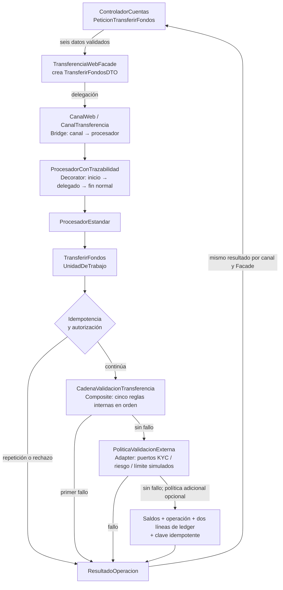

# Semana 9 — UML de Facade e integración

Estos diagramas describen la ruta web implementada, no todas las variantes posibles del Bridge. Las versiones PNG legibles para Word están en `Semana 9 - UML Facade.png` y `Semana 9 - UML Integrado.png`.

## Facade: frontera web y delegación

`ControladorCuentas` conserva validación HTTP, actor y respuesta. `TransferenciaWebFacade` recibe seis valores, crea `TransferirFondosDTO` y devuelve directamente el resultado de `CanalWeb`.

## Flujo integrado: cinco patrones

Las flechas representan el camino de una petición web con el binding actual de `ProcesadorTransferencia` en `AppServiceProvider`. El Composite interno se evalúa antes de la política externa Adapter; la política adicional es opcional. Un rechazo corta el flujo antes de escribir saldos o ledger.

**Referencias:** `app/Http/Controllers/ControladorCuentas.php`, `app/Application/Account/TransferenciaWebFacade.php`, `app/Application/Account/CanalTransferencia.php`, `app/Application/Account/ProcesadorConTrazabilidad.php`, `app/Application/Account/TransferirFondos.php`, `app/Application/Account/EspecificacionCompuestaTransferencia.php`, `app/Application/Account/PoliticaValidacionExterna.php`, `app/Providers/AppServiceProvider.php`. El flujo detallado y las limitaciones se explican en `Semana 9 - Facade.md`.
